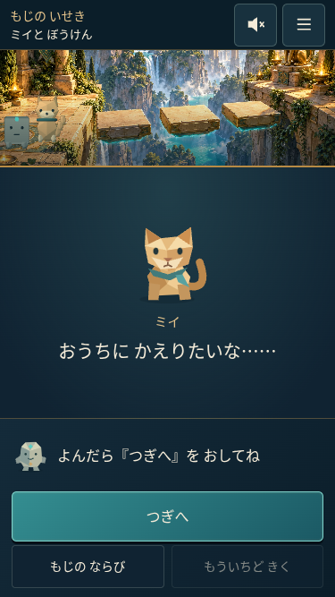
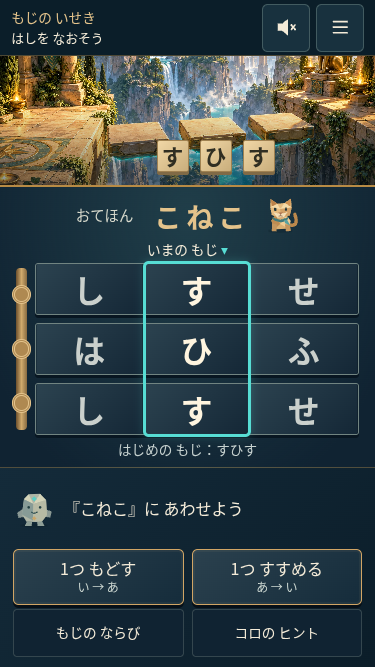
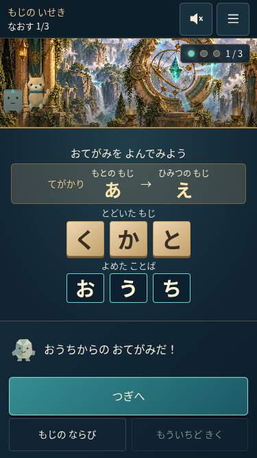

# 暗号の遺跡 — ミイをおうちへ帰す冒険

2026-10-11の小学1年生向け改訂仕様を実装。以前の「縦スクロールを許可」「英字26文字」の指示より、今回のスマホ1画面・ひらがな46文字・段階的な練習を優先しています。Nuxt 4・Vue 3・TypeScript・Babylon.js 8と既存の砂岩のイラストを継続使用し、依存の追加や他のページの刷新はありません。本番デプロイは行っていません。

## 起動と画面への経路

```sh
npm ci
npm run dev
```

`/games` →「暗号の遺跡」→ `/games/caesar/`。アクセスするとミイとコロの会話を1文ずつ表示し、「つぎへ」で練習に進みます。再アクセスでも導入を表示します。APIキー・ログイン・有料サービスは不要です。

プレイ中は小さなゲーム名・進行・音声・メニューだけを上部に残します。「もじの ならび」「あそびかた」「音声」「やり直し」「保護者への補足」はダイアログで開き、閉じると同じ問題へ戻ります。ゲーム一覧の既存ルビは維持し、子どもの操作盤はひらがなを中心にしています。

## 遊びの進行

| 場面 | 入力 | 目標・結果 | 操作 |
| --- | --- | --- | --- |
| 練習1：触る | い | あ | 「1つ もどす」だけを主操作に。コロと手のガイド |
| 練習2：合わせる | う | い | もどす／すすめる。任意ヒント |
| 練習3：連動 | うお | いえ | 2本が同時に1つ戻る。家の印 |
| 橋 | すひす | しはし → さのさ → こねこ | 同期した3本をボタン・ドラッグ・キーで動かす |
| 通信の練習 | あ → え | 移動回数 0 → 1 → 2 → 3 | 次に、え → う → い → あを確認。採点対象外 |
| おてがみ | くかと | おうち | 同じ記録「あ→え」から3つ戻す |
| おへんじ | ここ | すす | 3つ進める。相手でも「すす→ここ」と戻る演出 |
| 1文字の修正 | ひせ（元はねこ） | ひす | 2文字目を1つ戻す。他の場所を選ぶと前の修正を取り消す |
| 最後の扉 | えか、記録「あ→う」 | いえ | 新しい鍵で2つ戻す。修復3問とは別の記録 |
| おうち | ミイが帰る | お礼と3つの学び | 1文ずつ。「もういちど」「おしまい」 |

橋の中央選択位置が主役です。スマホでは各帯に前・現在・次の3文字、PCでは5文字を表示します。帯は左から右へ五十音順で、右ドラッグが「戻す」、左ドラッグが「進める」。3本の変位は共通で、確定時に橋の文字も更新します。1回のドラッグは最大2文字で、縦方向の操作は妨げません。右キーで戻し、左キーで進めることもできます。最初の練習ではボタンだけを使います。

通信機は「むきを選ぶ → かずを選ぶ → やってみる」。同じ操作領域を切り替え、戻っても方向と数を保持します。初期方向は未選択、数は0。選択中は結果を「？」にし、実行後だけ表示します。修正問題では選んだ文字だけを動かし、完成した文字列で判定します。

誤答は「ここを もういちど みてみよう」と手がかりの点灯で案内します。減点、赤い×、時間切れ、怖い音はありません。成功文は既存の案内領域を置き換え、「つぎへ」を押すまで次の問題に進みません。画面の切り替え直後・実行中・成功演出中の入力を状態遷移で制御し、連打で画面を飛ばさないようにしています。

## 画面と美術

プレイ領域は `100dvh`（`100vh`フォールバック）と行の高さを管理するグリッドで構成し、上下左右のsafe-areaを加味しています。問題と下部操作を重ねるfixedフッターや、操作盤を縮小するtransformは使っていません。本文の拡大時は最小高さが増え、ページスクロールで操作できます。ズームは禁止していません。横画面は世界・操作を左、問題を右に分けます。サイト全体のoverflowは変更しません。

既存の `public/caesar/bridge.webp` と `transmitter.webp` に、小さなローポリのミイ・コロ・足場・修復する光を重ねます。ミイは待機・喜ぶ・歩く反応をします。3D初期化が失敗した場合はイラスト、SVGのミイとコロ、CSSで動く足場・道の光を使い、問題はそのまま進められます。技術的な理由と再試行・画質はメニュー内へまとめました。3D表示不能を全端末共通の障害と扱いません。

## ロジック、保存、音声

| 責務 | 実装 |
| --- | --- |
| 46文字と変換・五十音の共通データ | `app/games/caesar/cipher.ts` |
| 練習・問題・正解・手がかり | `app/games/caesar/questions.ts` |
| 短い会話・子ども向け文言 | `app/games/caesar/adventure-copy.ts` |
| 画面・操作段階・入力制御 | `app/games/caesar/state.ts` |
| バージョン付き学習記録 | `app/games/caesar/progress.ts` |
| 日本語音声の検出・再生・停止 | `app/games/caesar/narration.ts` |
| UI・ダイアログ・同期する帯 | `app/components/games/caesar/` |
| 画面内グリッド・横画面・拡大 | `app/assets/css/caesar-adventure.css` |
| キャラクターと軽量な3D演出 | `app/games/caesar/scene.ts` |

46文字は「あいうえお…わをん」。`を`を含み、`ん`の次は`あ`、表の空欄は数えません。変換式は `((index + shift) % 46 + 46) % 46`、正数は進む、負数は戻る。3つ戻す／43進む、3つ進む／43戻す、2つ戻す／44進むは同じ答えとして受け付けます。採用した全問題を実際の変換関数で検証しています。

保存キーは `mirai-museum:caesar:v2`、`version: 2`・`curriculum: mii-home-1`。旧v1の問題の記録を今回の記録として読み替えません。旧キーは削除しません。通信機3問と最後の扉について、初回正誤・試行回数・使ったヒントの段階数を保存し、ガイド付き練習は除外します。再アクセスでは記録を保持し、終了画面の「もういちど」で新しい記録にリセットします。現在の問題のやり直しでは、それまでの試行を保持します。保存拒否でも遊びは続けられます。共通の博物館クリア記録も他ゲームを保持して更新します。

音声案内はブラウザ音声合成を初期実装として使用します。端末の日本語音声を検出し、ユーザー操作後にだけ開始します。画面・案内の変化、オフ、メニュー、タブ非表示、退出で古い読み上げを止め、同時に複数を再生しません。「おと」オン／オフと「もういちど きく」を用意し、音声がない場合は短い文字とガイドで進行します。録音素材は作成していません。

## 検証

```sh
npm run typecheck
npm test
npm run build
npx playwright test
npx playwright test --config playwright.runtime.config.ts tests/runtime-browser/caesar.spec.ts
```

本番ビルドのChromiumで、360×640・375×667・390×844の全行程を確認します。各画面でページの縦横スクロールが不要なこと、操作対象が48 CSS px以上あること、帯の文字が30px以上あること、メインボタン位置が会話・ヒント・正誤で変化しないことを測定します。44px上・34px下の余白も模擬し、viewport高の変更、横画面667×375、文字200%拡大も確認します。

タッチのドラッグ、同期する変位と確定した文字、キーボードでの全行程、同値シフト、誤答後の再試行、1か所修正の取り消し、連打、ダイアログの閉じる／フォーカス復帰、記録保持・保存拒否をブラウザで確認します。音声の開始・停止・重複防止は日本語音声APIの模擬で確認します。WebGLを明示的に無効化した場合と、描画コンテキストを失った場合も検証します。

2026-10-11の検証結果：型チェック・本番ビルド成功、単体テスト94件、本番ブラウザ11件（暗号ゲーム8件・既存ホーム／恐竜3件）、描画資源のブラウザ検証1件が通過しました。最終調整後にも、375×667の全行程（各確認画面で上下の余白も模擬）、日本語表示・ダイアログ・連打、音声の3件を再確認しました。

360×640・375×667・390×844では、導入から終了まで通常表示のページスクロールが不要でした。メイン操作位置、48px以上の操作対象、30px以上の帯の文字も各確認画面で測定しています。PC 1280×800、横画面667×375、文字200%拡大、タッチのドラッグ、キーボードでの全行程も通過しました。

6回のやり直し前後で33メッシュ・7マテリアルを維持しました。3回の退出ごとにEngine・Scene・描画ループ・登録listenerがすべて0、再入場で1・1・1・2に復帰しました。非表示タブではループ0、復帰で1。描画コンテキストを失ったときは資源を解放し、イラストを保持して新しいcanvasで再表示できました。ソフトウェアWebGLのFPSは実機性能の保証には使いません。

## スマホの画面例

本番用ビルドの実際の375×667 CSS pxの画面です。画像に文字を後から追加していません。

| 短いイントロ | 3本がつながる橋 | おてがみを読めたところ |
| --- | --- | --- |
|  |  |  |

## 残る確認

- 確認環境のLinux Chromiumには日本語音声がなく、`speechSynthesis.getVoices()` は空でした。実際の日本語の発音・音量は未確認です。音声なしの全行程と、模擬音声APIの開始・停止は別々に検証しています。
- iPhone Safariの実機、ブラウザバーの伸縮、実際のsafe-area、Android実機、Firefoxは未確認です。ブラウザサイズ変更と余白の模擬は実機確認の代わりではありません。
- 小学1年生の実際の試遊は未実施です。自動テストの成功だけで、誰でも理解できるとは断定しません。
- 公開中のURLは、この環境から取得できませんでした。リポジトリとローカルの本番ビルドを対象に改修・検証し、本番公開は行っていません。
