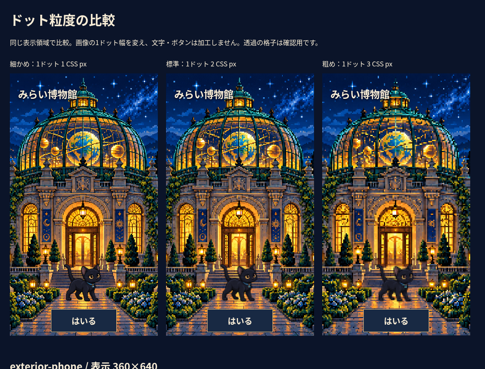

# 共通ドット絵変換ツール

元画像の大きさではなく、画面上の論理1ドットの幅を基準にします。代表的なスマホ360×640のレイアウトを確認し、描画解像度180×320、標準1ドット＝2 CSS pxとしました。背景と猫は同じ画像寸法にはしません。

| 用途 | 基準表示 | 加工後の標準解像度 | 表示倍率 |
| --- | --- | --- | --- |
| スマホ外観 | 360×640 | 180×320 | 2 |
| 小さな中庭 | 336×224（問題中は一部を表示） | 168×112 | 2 |
| 猫 | 96×96 | 48×48 | 2 |
| 大きな猫 | 128×128 | 64×64 | 2 |
| PC外観 | 1440×900 | 720×450 | 2 |

スマホには縦の基準を用い、横長のPC画像を縮めて押し込みません。横画面の外観は明示的な別の切り抜きです。390×844の森林の大きな表示にも対応する素材を別に設定しました。

## 実行

制作時だけ実行します。Node.js（既存の開発環境）と `ffmpeg` / `ffprobe` が必要です。追加のnpm依存はありません。FFmpegは読み込みとRGBAデコードに使い、縮小・パレット・PNG出力はNodeの標準ライブラリで実装しています。閲覧時にこれらを実行しません。

```sh
# macOSでFFmpegが未導入の場合
brew install ffmpeg
# Debian/Ubuntuの場合
sudo apt install ffmpeg

npm run assets:pixel
npm run assets:pixel -- --assets exterior-phone,ru-idle-128 --profiles fine,standard,coarse
npm run assets:pixel -- --config assets/pixel-art.config.json --out work/pixel-output --previews work/pixel-preview
node scripts/pixel-assets.mjs --help

# 比較ページを開く（プロジェクトのルートで）
python3 -m http.server 8010 --bind 127.0.0.1
# http://localhost:8010/docs/pixel-previews/index.html
```

Pythonは上の簡易プレビューサーバーの選択肢です。変換にPythonやPillowは使いません。生成されたindex.htmlを通常のブラウザで開く方法でも比較できます。

## 設定例

`assets/pixel-art.config.json` が共通設定です。単独の設定ファイルで次のように指定できます。

```json
{
  "version": 1,
  "reference": {
    "viewport": { "width": 360, "height": 640 },
    "render": { "width": 180, "height": 320 }
  },
  "profiles": {
    "fine": { "label": "細かめ", "pixelSize": 1 },
    "standard": { "label": "標準", "pixelSize": 2 },
    "coarse": { "label": "粗め", "pixelSize": 3 }
  },
  "defaults": {
    "downsample": "box", "colors": null, "palette": null,
    "dither": false, "previewScale": 2
  },
  "output": "public/museum/pixel",
  "previews": "docs/pixel-previews",
  "manifest": "app/museum/pixel-assets.generated.json",
  "assets": [{
    "id": "my-background",
    "input": "source-art/my-background.png",
    "display": { "x": 0, "y": 0, "width": 360, "height": 640 },
    "crop": { "x": 480, "y": 0, "width": 576, "height": 1024 }
  }]
}
```

表示幅・高さと1ドットの幅から、縦横比を保って入る解像度を計算します。端数は論理1ドット以内の丸めです。x/yは基準画面での使用位置です。cropは必要なときだけ指定し、元画像の範囲外や非整数の切り抜きは拒否します。指定しなければ全体を使い、勝手に切り抜きません。

各素材はdefaultsを上書きできます。`downsample: "box"`（`"area"`も可）は高精細な生成画向けの面積平均、`"nearest"`（`"nearest-neighbor"`も可）は既存のドット絵向け。現在の背景は元からドット絵なのでnearest、猫の大きな生成シートはboxを選びました。透明な部分のRGBが輪郭へ混じらないよう、boxではアルファを掛けて平均し、元へ戻します。透明度自体は維持し、完全透明部分のRGBは0にそろえます。

色数削減は `colors: 64` など2〜256色。既定はnullで削減しません。`palette: ["#101828", "#e8b86a"]` 等で任意パレットも指定できます。背景へUIの紺・金を強制しません。パレットはRGB、アルファは独立して保持します。ディザリングは既定false。trueは決定論的なFloyd–Steinbergですが、アニメーションのグループではちらつきを避けるため拒否します。

## アニメーション・猫

フレームごとに素材を列挙し、同じ `animationGroup` と `paletteGroup` を付けます。animationGroup内で解像度が異なると失敗します。paletteGroupは全フレームから一度だけパレットを計算し、単独フレームを選んで実行しても共通の色を使います。異なるcolors/palette指定の混在も拒否します。96px表示と128px表示は別のanimationGroupですが、Ru全体のpaletteGroupは共通です。

今回の専用シートは3つの姿を724×724セルで明示的に切り出しました。姿は立つ・走る・眠るで、連続した歩行の多フレーム素材ではありません。GIFや動画等の複数フレームのコンテナは、そのまま先頭だけ処理せず拒否します。フレームかシートのセルを明示してください。

## 出力と比較

- `public/museum/pixel/{fine,standard,coarse}/`：ネイティブ解像度のRGBA PNG。入力を上書きしません。
- `docs/pixel-previews/{fine,standard,coarse}/`：previewScaleの**整数倍nearest拡大**PNG。再生成できる重複画像なのでGitでは除外しています。
- `docs/pixel-previews/index.html`：同じ表示枠で3段階を比較。画像を各profileの整数倍率で表示し、HTMLの文字・ボタンは変換しません。スマホでは横へ比較できます。
- `docs/pixel-previews/comparison.png`：実際の360×640の3枠をブラウザで撮った比較。
- `docs/pixel-previews/report.json`：入力SHA-256、設定ハッシュ、出力寸法・ハッシュ、共通パレット。時刻や乱数は入れません。
- `app/museum/pixel-assets.generated.json`：標準素材と整数倍率の表示用マニフェスト。全素材・standardを通常の出力先へ作ったときに更新します。素材を一部だけ作る試行で、サイトの全マニフェストを消しません。



実行環境Node 24.19.0、FFmpeg 7.1.5で、同じ設定の全45出力を2回生成し、レポートと全SHA-256が一致しました。別バージョンのデコーダによる色変換の完全なバイト一致までは保証しません。

## サイトへの適用と限界

`PixelArt.vue` は加工済み画像を読むだけです。画像のnative寸法×2を固定し、幅・高さを半端な倍率で引き伸ばしません。画面の変化をResizeObserverで検出し、整数CSS pxの位置、余白と表示範囲で調整します。背景はphone / wide / landscapeを選び、猫も2倍nearestで表示します。文字・アイコン・ボタンを画像化しません。画面の拡大を禁止しません。

標準では、実際の透明な猫の目の琥珀色、首輪の青い石、足、半透明の輪郭が残ることをピクセル検査と表示で確認しました。BOXの透明な緑が赤い輪郭へ混じらないケース、nearestのRGBA完全複製、crop、共通パレット、PNGの決定性もテストしています。

粗め3pxでは、顔の細部・細い柵・屋根の細い装飾が省略されます。縮小で消えた特徴を自動で描き直す機能はありません。より小さな猫で目や首輪が必要な場合は、その表示用に形を手で整理するか、細かめを選び直す必要があります。現在のサイトは標準2pxを採用しています。整数ではないdevicePixelRatioやブラウザズームでの物理画素の完全一致、iPhone実機は未確認です。
