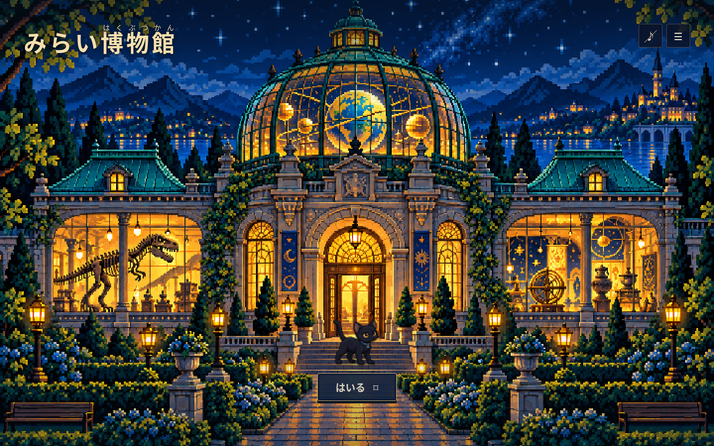
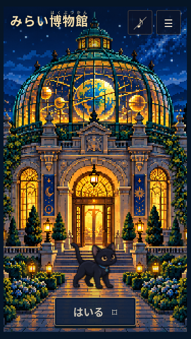
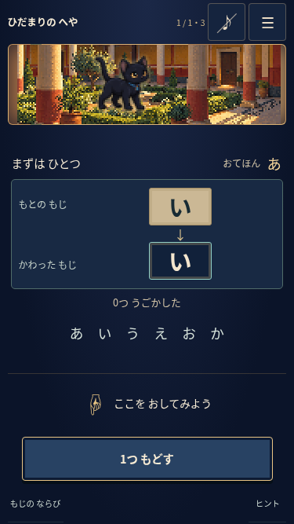
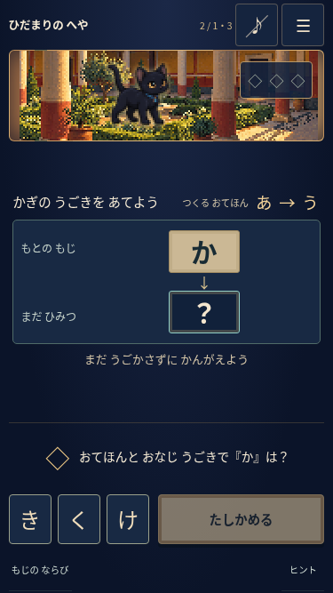
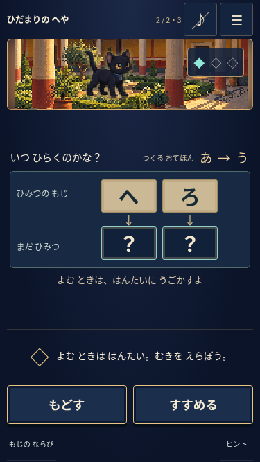
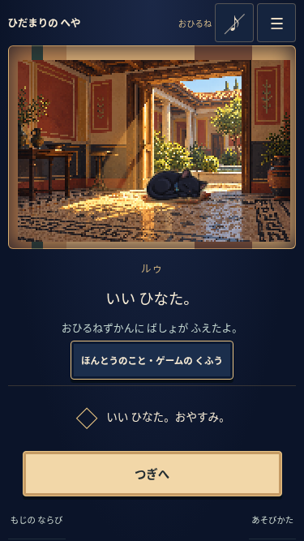
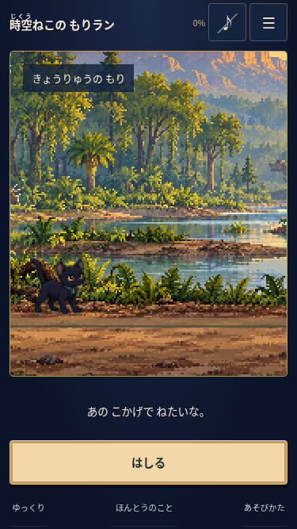

# みらい博物館：リニューアル検証記録

2026-10-11。既存のworkブランチ、2fb1dcaから改修しました。開始時の変更はなく、AGENTS.mdは見つかりませんでした。Nuxt/Vue/TypeScriptと既存のビルド方式を維持しました。本番デプロイは行っていません。

## 変更と確認方法

最新仕様は [リニューアル仕様](../museum-renewal.md) と [暗号ゲーム](../caesar-game.md)。正式タイトル、ゴシック体、ダークネイビー、短毛の黒猫ルゥ、語尾「にゃ」なし。トップから暗号ゲームへ直接入り、展示室はありません。音楽はオン／オフでき、読み上げはありません。恐竜操作の3Dランをドット絵の時空ねこランへ置き換え、旧URLを保持しました。

環境はLinux、Node 24.19.0、Nuxt 4.5.2 / Vue 3.5.43 / TypeScript 5.9.3、Chromium、Playwright 1.58.2。APIキー・追加の実行時依存は不要です。素材変換時はFFmpeg / ffprobe 7.1.5を使用しました。

```sh
npm run typecheck
npm test
npm run build
npm run test:browser
npm run test:runtime
```

型チェックと本番ビルドは成功。単体テスト120件（15ファイル）が通過しました。暗号変換・同期した操作・初回正誤とヒント・同値シフト・循環・保存の検証、新しいランの固定時刻判定とゆっくりモード、BGMのグラフと開始／停止、画像変換9件を含みます。従来の共通基盤・旧教材ユーティリティの回帰テストも残しています。120件すべてが新UIの試遊という意味ではありません。

## ブラウザで確認する範囲

- 360×640、375×667、390×844：導入から練習・予測・解読・正解・昼寝・学びまでの全行程。通常表示で縦横ページスクロールが不要、操作対象48px以上、主操作の位置が変化しないことを測定。
- 375×667：上44px・下34pxを模擬し、内容と操作が画面内に収まることを確認。これは実機のsafe-area確認ではありません。
- PC 1280×800／外観1440×900、横画面667×375：操作とダイアログ。200%文字拡大：スクロールを許可し、操作へ到達できること。
- 予測問題は動かす前に答え、選択中の結果は「？」。方向・数の選び直し、誤答後の再試行、ヒントの実演から元の設定へ復帰。成功中にメニューを開いても進行が止まらないこと。
- タッチの右スワイプ、ボタン、左右キーの変換一致。キーボードだけで昼寝まで進み、博物館へ戻ること。
- ランは実入力で9つの障害物を通過。失敗後の近くからの再試行、一時停止、画面の回転、クリアと寝床保存、再読込後の復元。
- 破損保存・旧教材v2を新教材のクリアにしないこと。保存拒否でもプレイ可能。
- 音楽の初期オフ、オン操作で開始、画面移動後も1つのAudioContext、タブ非表示で停止、復帰・オフ。読み上げAPIへのアクセス0。OfflineAudioContextで実際の合成関数が有限の非ゼロ波形を生成すること。
- 開発環境で3回の入退場：ランの予約フレームは走行1／一時停止0／非表示0／退出0。音楽は画面移動を繰り返してもAudioContext1つ。現行ページはcanvas0で、WebGLやGLBを読み込まないこと。
- `/`、`/games`、`/games/caesar/`、`/dinosaur?play=1`、`/naps`、`/about` を直リンクで確認。HTMLの言語とタイトルは日本語。

本番ビルドに対するブラウザテスト13件、開発環境の資源・退出テスト2件がすべて通過しました。画像表示は360×640、375×667、390×844、1440×900、844×390で、ネイティブ画像寸法の整数2倍、補間無効、入口が画面内にあることを測定しました。

## 共通の画像変換

[設定・実行方法・比較](../pixel-assets.md) を追加しました。実レイアウトに合わせた360×640／描画180×320を共通基準とし、背景と猫の表示寸法から別の解像度へ変換します。BOXとnearestの切り替え、アルファ保持、任意パレット、整数拡大、全姿の共通パレットを実装しました。

15素材を3段階へ加工した全45出力を同じ設定で2回生成し、レポートとSHA-256が一致しました。元画像のSHA-256も不変です。背景と透過猫はBOX方式でも別の出力先で試行しました。サイトには標準2 CSS pxを適用し、比較ページとキャプチャでは同じ360×640内で粒度を比べられます。

標準の96px／128px表示の猫で目・足・首輪の石を確認しました。粗め3pxで消える細い装飾や顔の細部は、自動変換だけでは描き直せません。加工済み素材と拡大プレビューは別の場所へ保存し、元画像を残しています。

## 実際の画面例

画像は本番ビルドのブラウザキャプチャです。文字を画像へ後から加えていません。



| 外観 375×667 | 練習 | 予測 |
| --- | --- | --- |
|  |  |  |

| 新しい鍵 | ごほうび | 時空ねこのラン |
| --- | --- | --- |
|  |  |  |

## 制約・未確認

- iPhone Safari、実際のブラウザバー伸縮とsafe-area、Android実機、Firefoxは未確認。サイズ・余白の模擬と実機確認は区別します。
- 実際の小学1年生による試遊は未実施。自動検証の成功だけで「誰でも理解できる」とは断定しません。
- BGMの波形・ブラウザ音声グラフは確認しますが、実機スピーカーでの音量・聴こえ方は未確認です。録音したBGMやナレーションを制作したとは報告しません。
- ルゥは3つの姿とCSSの軽い動き。複数フレームの歩行・まばたき・あくびの専用アニメーション素材は未制作です。
- 参考の博物館外観原画像は未添付だったため、今回の条件で新規生成。ゲーム背景は史料を参照した創作復元で、実在建物の正確な復元ではありません。
- 保存はこのブラウザ内のみ。端末間の同期やログインはありません。
- 公開中サイトはネットワーク制約で取得できず、既存リポジトリとローカルのビルドを対象に確認しました。pushと本番公開は別です。
